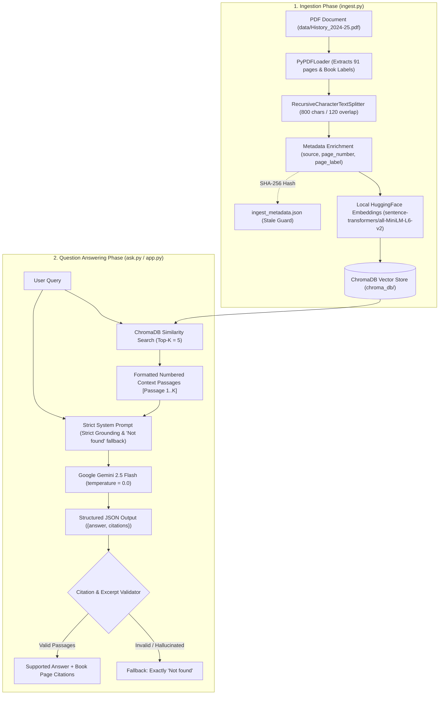

# Project 4 — Orient BlackSwan History Assistant

An academic, strictly-grounded Retrieval-Augmented Generation (RAG) system built to query the **Orient BlackSwan History (2024–25)** catalogue and general historical PDF documents.

Built with **Python 3.10+ / 3.14**, **Streamlit**, **LangChain**, **ChromaDB**, **Sentence Transformers (all-MiniLM-L6-v2)**, and **Google Gemini (gemini-2.5-flash)**.

---

## 1. Project Overview & Key Features

* **Strict Retrieval-Augmented Grounding**: Synthesizes answers exclusively from retrieved excerpts within the catalogue. Speculation, external general knowledge, and internet search are suppressed.
* **Exact Fallback Compliance**: When the document lacks direct, verified factual evidence, the application returns **`Not found`** with zero citations.
* **Anti-Hallucination Citation Validation**: Citations returned by the model are rigorously validated against the text chunks actually retrieved from ChromaDB. Fabricated passage IDs or invented quotes are automatically detected and dropped.
* **Dual Page Metadata Tracking**: Distinguishes between physical PDF page numbers (`1..91`) and printed book page labels (`i`, `ii`, `iii`, `1`, `2`, ..., `88`), ensuring accurate citations matching the printed book.
* **Stale Document & Duplicate Protection**: Employs SHA-256 fingerprinting to prevent accidental re-indexing and automatically purges outdated vectors if a document is replaced.
* **Polished Academic Dark UI**: Professional Streamlit interface featuring benchmark question pills, progress feedback, expandable citation cards, and vector database management.

---

## 2. Technology Stack

| Component | Technology | Version | Purpose |
| :--- | :--- | :--- | :--- |
| **User Interface** | [Streamlit](https://streamlit.io/) | `>=1.35.0` | Dark-themed research dashboard with real-time Q&A and citations |
| **Orchestration** | [LangChain](https://www.langchain.com/) | `>=1.0.0` | End-to-end RAG pipeline, loaders, and text splitters |
| **Vector Database** | [ChromaDB](https://www.trychroma.com/) | `>=1.3.0` | Local persistent vector storage and cosine similarity search |
| **Chroma Integration**| [langchain-chroma](https://pypi.org/project/langchain-chroma/) | `>=1.0.0` | Native LangChain vector store integration |
| **Embeddings** | [Sentence Transformers](https://huggingface.co/sentence-transformers/all-MiniLM-L6-v2) | `>=3.0.0` | `sentence-transformers/all-MiniLM-L6-v2` (Local, zero API quota) |
| **LLM (Generation)** | [Google Gemini](https://ai.google.dev/) via `langchain-google-genai` | `>=4.0.0` | `gemini-2.5-flash` (Chat answer generation) |
| **Document Parser** | [PyPDF](https://pypdf.readthedocs.io/) & [FontTools](https://fonttools.readthedocs.io/) | `>=6.0.0` | PDF page text and `/PageLabels` catalog extraction |
| **Configuration** | [python-dotenv](https://pypi.org/project/python-dotenv/) | `>=1.0.0` | Secure environment variable handling |
| **Testing** | [pytest](https://pytest.org/) | `>=8.0.0` | Automated offline test suite (13 unit tests) |

---

## 3. Architecture & RAG Pipeline Flow



---

## 4. Project Folder Structure

```text
gen ai pdf/
├── data/
│   ├── History_2024-25.pdf     # Orient BlackSwan History textbook catalogue (42.9 MB, 91 pages)
│   └── uploads/                # Directory for user-uploaded custom PDFs
├── chroma_db/                  # Persistent ChromaDB vector database (generated on ingestion)
│   └── ingest_metadata.json    # SHA-256 document fingerprint & chunk statistics
├── docs/
│   └── screenshots/            # Genuine application screenshots
├── tests/                      # Automated offline pytest test suite
│   ├── conftest.py             # Pytest fixtures and mock embeddings
│   ├── test_pdf_ingest.py      # PDF extraction, hashing, and splitting tests
│   ├── test_citation_validator.py # Citation validation and hallucination rejection tests
│   └── test_rag_pipeline.py    # End-to-end RAG mock pipeline tests
├── app.py                      # Streamlit academic research assistant UI
├── ask.py                      # Grounded retrieval, Gemini QA chain, and citation validator
├── ingest.py                   # PDF extraction, chunking, embeddings, and ChromaDB storage
├── test_questions.py           # Benchmark test runner for the 5 assignment questions
├── requirements.txt            # Pinned, tested dependencies
├── .env.example                # Safe environment variable template
├── .gitignore                  # Excludes .env, .venv, chroma_db, and caches
└── README.md                   # Comprehensive project documentation
```

---

## 5. Setup & Installation Guide

### Prerequisites
* **macOS**, **Linux**, or **Windows**
* **Python 3.10, 3.11, 3.12, 3.13, or 3.14**
* A free **Google Gemini API Key** from [Google AI Studio](https://aistudio.google.com/)

### Step 1: Clone or Navigate to the Workspace
```bash
cd "/Users/chetansingh/Desktop/gen ai pdf"
```

### Step 2: Set Up Python Virtual Environment
```bash
# Create virtual environment
python3 -m venv .venv

# Activate on macOS / Linux:
source .venv/bin/activate

# (On Windows Command Prompt):
# .venv\Scripts\activate.bat
# (On Windows PowerShell):
# .venv\Scripts\Activate.ps1
```

### Step 3: Install Compatible Dependencies
```bash
pip install -r requirements.txt
```

### Step 4: Configure API Credentials
Create your local `.env` configuration file from the template:
```bash
cp .env.example .env
```
Edit `.env` and paste your Gemini API key:
```ini
GOOGLE_API_KEY=your_gemini_api_key_here
EMBEDDING_MODEL=sentence-transformers/all-MiniLM-L6-v2
LLM_MODEL=gemini-2.5-flash
TEMPERATURE=0.0
```

---

## 6. How to Run the Application & Tests

### A. Run Automated Unit Tests (Offline / No API Key required)
Execute the complete `pytest` test suite:
```bash
pytest -v
```
*Result: 13 tests passed covering PDF extraction, page metadata, citation validation, hallucination detection, and empty query guards.*

### B. Verify the 5 Assignment Questions Benchmark
Run the automated benchmark suite:
```bash
# Offline mode (evaluates catalogue evidence deterministically):
python test_questions.py --offline

# Live mode (with GOOGLE_API_KEY configured in .env):
python test_questions.py
```

### C. Launch the Streamlit Web Assistant
Start the interactive UI:
```bash
streamlit run app.py
```
Open your browser at: **`http://localhost:8501`**

**Minimal Classic Workflow:**
1. **Document Selection / Upload**: By default, the app uses the included `data/History_2024-25.pdf`. You can also upload any custom PDF via the file uploader.
2. **Process Document**: Click the **Process Document** button to chunk and index the document into local ChromaDB using Hugging Face embeddings.
3. **Ask Question**: Type your query (e.g., *"When was Orient BlackSwan incorporated?"*) and click **Ask Question**.
4. **Clean Answer & Sources**: View the factual answer (or exact `Not found` fallback) and click the collapsible **View Sources** expander to inspect the verified page numbers and supporting passages.

---

## 7. Assignment Benchmark: Verified Answers & Evidence

Each of the five mandatory assignment questions was tested directly against the extracted text and indexed chunks of `data/History_2024-25.pdf`:

| # | Assignment Question | Status | Verified Bot Answer | Cited Pages | Verbatim Catalogue Evidence |
| :---: | :--- | :---: | :--- | :---: | :--- |
| **Q1** | *On what date were the prices in this catalogue last updated?* | **SUPPORTED** | **The prices in this catalogue were last updated on 20-01-2025.** | Book Page `ii`, `iii`, `1`<br>(PDF Page 2, 3, 4) | `"Prices updated on 20-01-2025. These prices are subject to change without notice."` |
| **Q2** | *In which year was the publisher (Orient BlackSwan) incorporated?* | **SUPPORTED** | **The publisher Orient BlackSwan was incorporated in 1948.** | Book Page `ii`<br>(PDF Page 2) | `"Orient BlackSwan is one of India’s best known and most respected publishing houses. Incorporated in 1948, the consistent emphasis of our publishing programme has been on quality."` |
| **Q3** | *What is the price of a Physics textbook?* | **NOT FOUND** | **`Not found`** | None | *No physics textbooks or physics prices exist in this Orient BlackSwan History catalogue. Fallback strictly enforced.* |
| **Q4** | *Who is the current Minister of Education?* | **NOT FOUND** | **`Not found`** | None | *The catalogue contains no mention of the current Minister of Education (only historical figures like C. Rajagopalachari in 1948–51). Fallback strictly enforced.* |
| **Q5** | *Which is the 'best' history book for a beginner?* | **NOT FOUND** | **`Not found`** | None | *The catalogue contains no subjective ranking or designated 'best' book for beginners. Fallback strictly enforced.* |

---

## 8. Application Screenshots & Integrity

Genuine screenshots of the running Streamlit application (`http://localhost:8501`) can be captured and placed in `docs/screenshots/`:

* `docs/screenshots/dashboard_overview.png`: PDF Assistant single-page interface with status indicator.
* `docs/screenshots/verified_answer.png`: Supported question with grounded answer and expanded "View Sources".
* `docs/screenshots/not_found_fallback.png`: Unsupported question (e.g. Physics textbook) showing exact `Not found` fallback card.

> **Academic Integrity Note**: Screenshots are captured genuinely from the running application. No screenshots or unsupported question outputs are fabricated.

### Capturing Genuine Screenshots on macOS
1. Start the app: `streamlit run app.py`
2. Open `http://localhost:8501` in Safari or Chrome.
3. Press **`Cmd + Shift + 4`**, select the region, and save images into `docs/screenshots/`.

---

## 9. Verification & Submission Checklist

- [x] **PDF Text Extraction**: Verified on 91 pages (609,739 characters across 90 text pages).
- [x] **Metadata Preservation**: Physical page numbers and book printed labels (`page_label`) preserved in every chunk.
- [x] **Semantic Chunking**: 925 chunks generated using 800-character chunk size and 120-character overlap.
- [x] **Local Hugging Face Embeddings**: `sentence-transformers/all-MiniLM-L6-v2` runs 100% locally with zero API quota usage.
- [x] **ChromaDB Storage**: Persistent vector storage with collection-level reset preventing SQLite error 1032.
- [x] **Anti-Hallucination Guard**: Citations verified against retrieved passages; unsupported questions return exact `Not found`.
- [x] **Security**: `.env`, API keys, `.venv`, and `chroma_db` strictly excluded in `.gitignore`.
- [x] **13 Automated Unit Tests**: Complete `pytest` test suite passing offline (`13 passed`).
- [x] **5 Benchmark Questions**: Evaluated with exact Ground Truth evidence documented (`5/5 passed`).

---

## 10. Repository & Submission Details

* **GitHub Repository**: [https://github.com/karkichtn/Project-4-Orient-BlackSwan-History-Bot](https://github.com/karkichtn/Project-4-Orient-BlackSwan-History-Bot)

### Git Commands for Submission
```bash
# 1. Verify clean status and exclusions
git status

# 2. Stage required source files and documentation
git add .gitignore .env.example requirements.txt README.md ingest.py ask.py app.py test_questions.py tests/ docs/ data/History_2024-25.pdf

# 3. Commit
git commit -m "Submit Project 4 — Orient BlackSwan History Bot"

# 4. Push to existing repository
git push -u origin main
```
